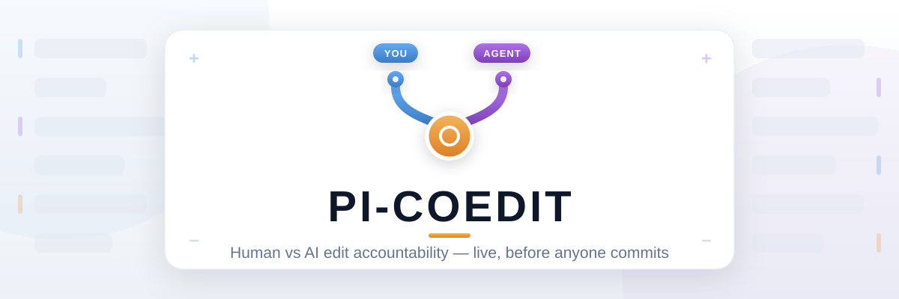

<div align="center">
  
</div>

<div align="center">

[](#)
[](https://github.com/earendil-works/pi)
[](packages/coedit-gutter)
[](EVIDENCE.md)
[](LICENSE)

</div>

<br/>

## Introduction

You code with an AI agent in the same repo — and after a while nobody can say who wrote which line, the agent silently overwrites your edits, and when tests break you have no idea *which* agent turn did it.

**pi-coedit** fixes that. Every line is attributed to **you 🟦 · agent 🟪 · both 🟧 · unclear ⬜** — live, while you both work, before anyone commits. The agent is told about your edits, blocked from clobbering them, and every commit carries the exact edits, prompts and cost that produced it.

## 📦 What's inside

<table>
<tr><td valign="top">

**Live awareness**
| # | Package | What you get |
|---|---|---|
| 1 | [`pi-coedit`](packages/pi-coedit) | pi plugin — the agent sees your edits, can't overwrite them, `/whose` shows who wrote each line |
| 2 | [`coedit-gutter`](packages/coedit-gutter) | VS Code / Cursor / Windsurf — live 🟦🟪🟧⬜ gutters, hover any agent line for its prompt & session |

</td><td valign="top">

**Power tools**
| # | Package | What you get |
|---|---|---|
| 3 | [`pi-bisect`](packages/pi-bisect) | `/bisect "npm test"` → names the exact agent edit that broke the build, reverts only it |
| 4 | [`pi-ledger`](packages/pi-ledger) | every commit gets a cost note — tokens, dollars, models — `pi-ledger range main..HEAD` |
| 5 | [`@coedit/core`](packages/core) | the engine all of the above share (bundled in, nothing extra to install) |

</td></tr>
</table>

## 🚀 Install

**In pi** — one command per plugin, no build step, no clone:

```bash
pi install npm:pi-coedit          # live awareness + overwrite protection
pi install npm:pi-bisect          # /bisect for agent regressions
pi install npm:pi-coedit-ledger   # cost notes on every commit

pi-ledger install                 # (optional) cost note hook on git commit
```

**In your editor** — install once, works in VS Code, Cursor and Windsurf:

```bash
code --install-extension coedit-dev.coedit-gutter
```

or grab the `.vsix` from the [releases page](https://github.com/AadiVerma/pi-coedit/releases) and install it manually.

That's it. Open a repo, run pi, start typing — the footer shows `✍️ you 3 files · 🤖 agent 7 · ⚠️ 1 unknown` the moment both of you have touched the code.

> **Status:** packages are publish-ready and waiting on the final go-ahead — until the first `npm publish` / Marketplace release lands, the from-source instructions in the **Development** section below are the way to run them today.

## 💬 Commands you'll actually use

| Command | What it does |
|---|---|
| `/whose <file>` | per-line authorship: 🟦 you · 🟪 agent · 🟧 both · ⬜ unclear — with the session, turn and prompt behind every agent line |
| `/coedit status` | what's attributed so far, watcher + guard state |
| `/coedit doctor` | store writable? watcher running? Git AI detected? |
| `/bisect "npm test"` | binary-searches the agent's own edits in a throwaway worktree → the one that broke it, with its prompt; `--revert` undoes only that edit |
| `/ledger install` | attach a post-commit hook that writes a cost note to every commit |
| `pi-ledger range main..HEAD` | tokens + dollars for the whole PR, ready to paste into the description |
| `coedit_whose` | a read-only tool the *agent* can call to check what you changed |

## 🛡️ How the agent can't ruin your day

When the agent tries to `edit` a file you changed since it last read it:

1. pi blocks the call and tells it why — including your diff;
2. the agent re-reads, merges your changes, and retries;
3. or you choose *allow anyway* / *cancel* in the TUI.

Policy is yours: `block` / `ask` (default) / `warn` / `off`.

## 🧩 Build your own pi plugin

This monorepo doubles as a template for writing pi packages. If you want to *use* coedit, the **Install** section above is all you need — this part is for extending it:

```bash
git clone https://github.com/AadiVerma/pi-coedit.git
cd pi-coedit && npm install

npm run new my-awesome-plugin -- "Does something awesome"
pi -e ./packages/my-awesome-plugin   # try it instantly, no publish needed
```

You get the full pi package anatomy for free — the `"pi"` manifest, `pi-package` keyword for the pi.dev gallery, host packages as `peerDependencies: "*"` (never bundled), esbuild bundling, tests and CI rules. Look at [`packages/pi-coedit/src/index.ts`](packages/pi-coedit/src/index.ts) for a complete working example of commands, tools and event hooks. `npm run check` enforces the monorepo rules before anything ships.

## 🤝 Works with Git AI

[Git AI](https://github.com/git-ai-project/git-ai) records attribution **after commit**; coedit covers everything **before** it. They coexist: coedit never touches Git AI's `refs/notes/ai` while `git-ai` is installed, reads its notes read-only, and can write a standard-compliant authorship log itself when Git AI is absent. Details in [docs/PLAN.md](docs/PLAN.md).

## 📚 Learn more

| Doc | |
|---|---|
| [docs/PLAN.md](docs/PLAN.md) | verified environment facts · prior-art survey · Git AI interop decision |
| [docs/QA-PLAN.md](docs/QA-PLAN.md) | how this is tested — matrices, fuzz suites, 7,400+ cases per run |
| [EVIDENCE.md](EVIDENCE.md) | build-order evidence trail + the QA bug ledger |
| [packages/core](packages/core) | the attribution model, store layout, detection rules, limits |

## ⚠️ Notes

- Node ≥ 22, pi 1.4+, VS Code ≥ 1.90 for the gutter extension
- prompt excerpts are capped at 200 chars and can be turned off; notes stay local until *you* push them
- publishing (npm / Marketplace) is manual and maintainer-approved — never automated

## 🛠️ Development

For contributing or running from source:

```bash
git clone https://github.com/AadiVerma/pi-coedit.git
cd pi-coedit && npm install
npm run check        # package checks + typecheck + 114 test blocks (7,400+ cases)

# try any plugin from source
npm run build && pi -e ./packages/pi-coedit

# package the editor extension locally
cd packages/coedit-gutter && npm run package
```

Demos run the real pi agent loop offline (scripted provider, no credentials needed):

```bash
node scripts/demo/run-coedit-demo.mjs [--stale]
node scripts/demo/run-bisect-demo.mjs
node scripts/demo/run-ledger-demo.mjs
```

Every pi command and tool name is registered and uniqueness-checked; core changes require core tests; each package keeps its README and CHANGELOG current; changesets accompany user-visible changes.

## License

[MIT](LICENSE) © Aditya
